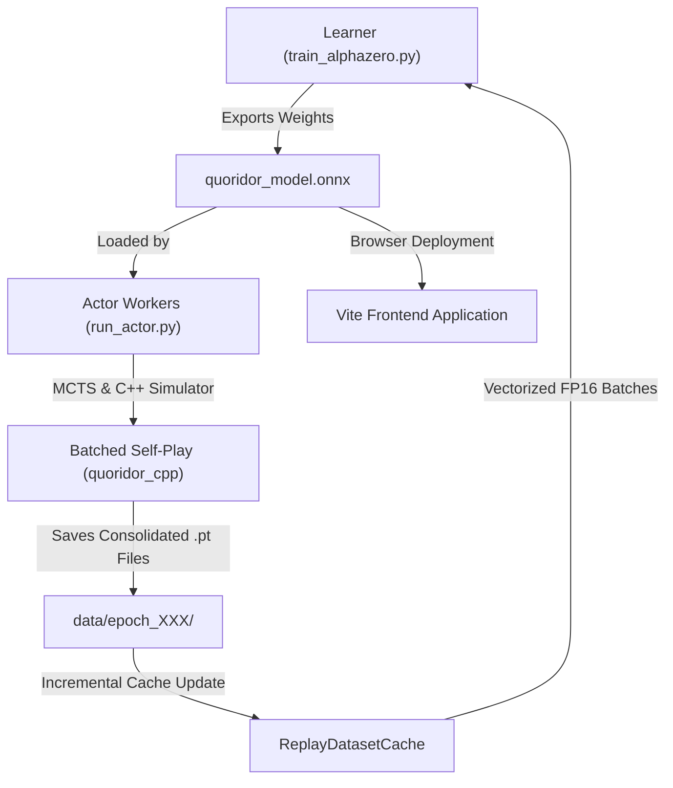

# Quoridor AlphaZero Architecture & System Design

This document details the high-level architecture, module design, data flow, and performance optimizations of the Quoridor AlphaZero reinforcement learning framework.

---

## 1. System Overview & Data Flow

The training pipeline uses an **Asynchronous Actor-Learner Architecture**. High-throughput C++ actor processes generate self-play games in parallel while a PyTorch learner process trains the neural network on GPU using Automatic Mixed Precision (AMP).

---

## 2. Component Breakdown

### A. C++ Core Engine & MCTS ([cpp/](../cpp))
- **`QuoridorGame`**: High-performance game state representation, move generator, wall placement validator, and BFS shortest pathfinder. Exposed to Python via `pybind11` in `quoridor_cpp`.
- **`MCTS` Engine**: Implements Monte Carlo Tree Search with PUCT selection formula ($c_{\text{puct}} = 1.4$) and Dirichlet noise ($\alpha = 0.3, \epsilon = 0.15$). Supports batched search execution (`MCTS.run_search_batched`) to unlock GPU inference parallelization.

### B. Self-Play Actor Workers ([run_actor.py](../run_actor.py))
- **Parallel Workers**: Multiple independent actor processes (`run_actor.py`) run in parallel.
- **ONNX Model Evaluator**: Loads `quoridor_model.onnx` using [ONNXModelEvaluator](../onnx_inference.py#L4-L53) with hardware-accelerated execution providers (`CUDAExecutionProvider`, `TensorrtExecutionProvider`, `DmlExecutionProvider`, or `CPUExecutionProvider`).
- **Consolidated Batch File Saving**: Self-play trajectories are saved into consolidated files containing entire game batches (`games_32_<timestamp>_<uuid>.pt`), reducing disk file creation by 32x.

### C. Neural Network & Learner ([train_alphazero.py](../train_alphazero.py) & [quoridor_model.py](../quoridor_model.py))
- **Network Topology ([QuoridorNet](../quoridor_model.py#L24-L75))**:
  - Input: `(11, 9, 9)` spatial board tensor (including active/opponent positions, wall maps, BFS path masks, normalized shortest path distances, and wall counts).
  - Perspective Rotation: State rotated by 180° on P2 turn to maintain active-player symmetry.
  - Convolutional Trunk: 10 Residual Blocks with 128 channels.
  - Policy Head: Outputs 140 raw action logits (12 move/jumps + 64 horizontal walls + 64 vertical walls).
  - Value Head: Outputs scalar $V \in [-1.0, 1.0]$.
- **Learner Optimizations**:
  - [ReplayDatasetCache](../train_alphazero.py#L109-L153): In-memory incremental data loader that reads only newly generated batch files per epoch, preventing disk I/O bottlenecks.
  - **Vectorized Pre-Stacked Tensors**: Pre-stacks dataset elements into contiguous PyTorch tensors for zero-copy CPU-to-GPU transfers (`non_blocking=True`).
  - **Automatic Mixed Precision (AMP / FP16)**: Uses `torch.amp.autocast('cuda')` and `GradScaler` for 2x-3x faster backpropagation on Tensor Cores.
  - **cuDNN Autotuning**: Enables `torch.backends.cudnn.benchmark = True`.

---

## 3. Training & Evaluation Pipeline

1. **Self-Play Generation**: Background actors simulate games using ONNX MCTS lookahead. The first 6 turns use proportional sampling over pawn moves for exploration before switching to greedy selection.
2. **Dataset Updates**: Completed batch trajectories (augmented with horizontal board symmetry) are saved to `data/epoch_XXX/`.
3. **GPU Training Pass**: The learner updates `ReplayDatasetCache`, pre-stacks tensors, shuffles mini-batches (size 64 by default), computes Policy Cross-Entropy and Value MSE loss, and steps the Adam optimizer with `StepLR` (gamma 0.8 every 50 epochs).
4. **ONNX Synchronization**: Newly updated checkpoint weights are exported to `quoridor_model.onnx` so actor processes automatically hot-reload the latest model.
