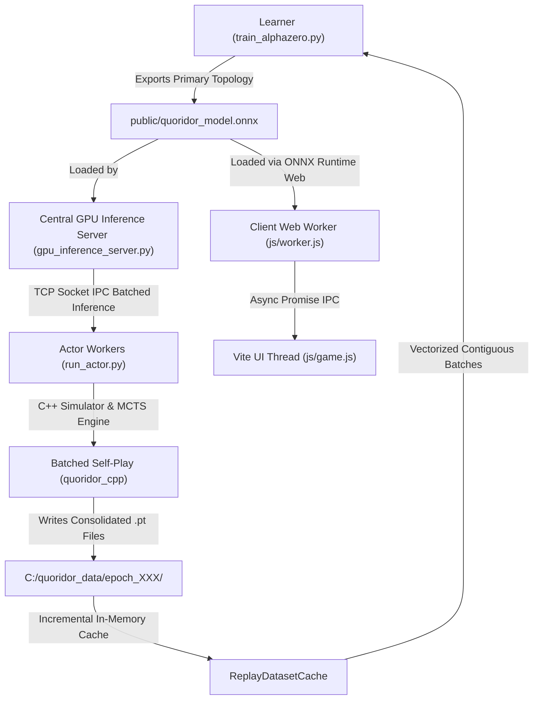

# Quoridor AlphaZero Architecture & System Design

This document details the system design, neural network topology, Monte Carlo Tree Search (MCTS) engine, data flow, and comparative evolution between QuoridorNet v1 and QuoridorNet v2.

---

## 1. System Overview & Data Flow

The training pipeline uses an **Asynchronous Actor-Learner Architecture**. Parallel C++ actor processes generate self-play trajectories while a PyTorch learner process trains the neural network on GPU using Automatic Mixed Precision (AMP).



---

## 2. Component Breakdown

### A. C++ Core Engine & MCTS ([cpp/quoridor_simulator.cpp](cpp/quoridor_simulator.cpp) & [cpp/mcts.cpp](cpp/mcts.cpp))
- **`QuoridorGame`**: High-performance game state representation, bit-packed wall tracking, jump action validator, and BFS pathfinder. Exposed to Python via `pybind11` in [cpp/bindings.cpp](cpp/bindings.cpp).
- **`encode_state_cpp`**: Generates the 11-channel input tensor directly in C++, computing multi-source 2D Reverse-BFS distance maps and All-Shortest-Paths DAG Criticality masks without Python interpreter overhead.
- **`MCTS` Engine**: Implements Monte Carlo Tree Search with Gumbel AlphaZero sequential halving and PUCT selection. Allocates a fresh root node per turn in batch self-play to avoid candidate pruning bias. Supports virtual loss parallel batching to aggregate evaluation requests across multiple tree traversals.

### B. Centralized GPU Inference Server ([gpu_inference_server.py](gpu_inference_server.py))
- **Single GPU Context**: Dedicated process hosting PyTorch TorchScript JIT execution with CUDA AMP on Tensor Cores.
- **Dynamic Micro-Batching**: Receives `(M, 11, 9, 9)` evaluation requests from all connected actors over TCP socket IPC with `TCP_NODELAY`, batches requests up to size 256–512, and runs single unified GPU forward passes.
- **Auto Model Reloading**: Polls for updated model checkpoints (`quoridor_checkpoint.pth`) per epoch and hot-reloads model weights seamlessly into the JIT execution context.

### C. Self-Play Actor Workers ([run_actor.py](run_actor.py))
- **Parallel Workers**: Multiple independent actor processes run in parallel.
- **Remote Model Evaluator ([onnx_inference.py](onnx_inference.py))**: Transmits state tensors over low-latency TCP sockets to `gpu_inference_server.py`, receiving sliced policy and value arrays. Standalone mode provides fallback to local ONNX execution.
- **Consolidated Batch File Saving**: Self-play trajectories are saved into consolidated files containing full game batches (`games_32_<timestamp>_<uuid>.pt`), avoiding filesystem metadata thrashing.

### D. Neural Network & Learner ([train_alphazero.py](train_alphazero.py) & [quoridor_model.py](quoridor_model.py))
- **Trunk**: 20 Residual Blocks with 192 channels, incorporating KataGo Global Pooling (spatial mean + spatial max concatenated) channel attention.
- **Decoupled Spatial Policy Head**: 12-pawn linear projection sub-head and 128-wall unpadded $2 \times 2$ spatial convolution sub-head.
- **Value Head**: Outputs scalar $V \in [-1.0, 1.0]$.
- **Auxiliary Heads**: Predicts terminal path lengths, terminal wall ownership grids, and opponent next-move distributions during training. Stripped during ONNX export for zero deployment overhead.
- **Learner Optimizations**:
  - `ReplayDatasetCache`: In-memory incremental data loader reading only newly added batch files each epoch.
  - Vectorized pre-stacked tensors for zero-copy CPU-to-GPU transfers (`non_blocking=True`).
  - Automatic Mixed Precision (`torch.amp.autocast('cuda')`) with gradient scaling.
  - cuDNN autotuning (`torch.backends.cudnn.benchmark = True`).

### E. Web Frontend & Client Worker ([js/worker.js](js/worker.js) & [js/ai-mcts.js](js/ai-mcts.js))
- **Web Worker Offloading**: All heavy computations (AlphaZero MCTS lookahead, Minimax move generation, depth-4 move quality analysis) run off the main UI thread in a background ES module Web Worker.
- **Subtree Reuse & 300 Simulation Budget**: The search engine preserves matching subtrees across consecutive plies, carrying forward visit counts and action values. Trees are automatically flushed on undo or history jumps.
- **Canonical State Hash Repetition Discounting**: Collects 64-bit state hashes across the last 8 plies and applies a $0.65\times$ visit discount to cycling actions during final move selection, preventing 2-tempo loops without distorting search exploration.
- **Reflection-Symmetrized Eval Bar**: Evaluates board states and their horizontal mirrors simultaneously: $V_{\text{symmetrized}}(s) = \frac{V(s) + V(\text{mirror}(s))}{2}$, eliminating lateral convolution noise.
- **WASM Multi-Threading**: Configures ONNX Runtime Web with WebAssembly multi-threading (`ort.env.wasm.numThreads = navigator.hardwareConcurrency || 4`) inside the worker thread context.

---

## 3. Architecture Comparison: Old (v1) vs New (v2)

### High-Level Specification Differences

```
QuoridorNet v1 (Baseline):
  Input Tensor:      (11, 9, 9) with constant scalar distances and arbitrary single-path masks
  Trunk:             10 ResBlocks, 128 Channels
  Attention:         Squeeze-and-Excitation with spatial mean-only pooling
  Policy Head:       Monolithic Linear(10368 -> 140) (~2.18M parameters)
  Auxiliary Heads:   None or redundant current-turn path prediction
  Total Parameters:  ~4.8M parameters

QuoridorNet v2 (Overhauled):
  Input Tensor:      (11, 9, 9) with 2D Reverse-BFS distance maps and All-Shortest-Paths DAG masks
  Trunk:             20 ResBlocks, 192 Channels
  Attention:         KataGo Global Pooling (spatial mean + spatial max concatenated)
  Policy Head:       Decoupled (12-pawn Linear + 2x8x8 Spatial Conv Wall Head, <15K parameters)
  Auxiliary Heads:   Terminal Path (2), Final Wall Grid (2x8x8), Opponent Next Policy (140)
  Total Parameters:  ~14.2M parameters (Trunk expanded; Head parameters reduced by 85%)
```

### Detailed Design Justifications

#### 1. 2D Reverse-BFS Distance Maps vs Constant Scalar Planes
- **v1 Design**: Channels 4 and 5 filled all 81 coordinates with a single broadcast scalar value $\min(d / 20.0, 1.0)$.
- **Limitation**: Any $3 \times 3$ convolutional kernel computing spatial derivatives across the plane observed:
  $$\frac{\partial R}{\partial x} = 0, \quad \frac{\partial R}{\partial y} = 0$$
  The network received magnitude information about how far the player was from the goal, but zero spatial directionality indicating which adjacent step reduced the distance.
- **v2 Solution**: Channels 4 and 5 compute a multi-source Reverse-BFS starting from all cells along the target goal row ($y=8$ for active player, $y=0$ for opponent). Every cell $(x, y)$ stores its exact distance to the goal line.
- **Impact**: The spatial gradient $\nabla R(x, y)$ provides local filters with an immediate directional vector pointing toward the shortest route to victory.

#### 2. All-Shortest-Paths DAG Criticality Maps vs Arbitrary Single-Path Masks
- **v1 Design**: Channels 6 and 7 computed a single shortest path using BFS with fixed neighbor order (North, East, South, West).
- **Limitation**:
  1. Arbitrary tie-breaking broke left-right reflection symmetry. When a state was mirrored horizontally for data augmentation, the flipped target path often failed to match the path generated from the mirrored state.
  2. A single path masked alternative paths of equal length, concealing topological choke points where all valid paths intersect.
- **v2 Solution**: Channels 6 and 7 compute the Directed Acyclic Graph (DAG) of all shortest paths. A cell $(x, y)$ belongs to the DAG if and only if:
  $$d_{\text{pawn}}(x, y) + d_{\text{goal}}(x, y) = d_{\min}$$
- **Impact**: All candidate shortest routes are marked simultaneously. Cells traversed by every path exhibit maximal flow, identifying critical bottlenecks that dictate wall placement. The representation is strictly invariant under horizontal reflection.

#### 3. KataGo Global Pooling vs Mean-Only SE Attention
- **v1 Design**: Standard Squeeze-and-Excitation computed channel summary statistics by taking the spatial mean:
  $$s_c = \frac{1}{81} \sum_{i=1}^{9} \sum_{j=1}^{9} x_{c, i, j}$$
- **Limitation**: A critical feature in Quoridor (e.g., an opponent pawn poised on a jump square, or a single open cell in a wall barrier) creates a sharp activation in 1 out of 81 cells. Averaging over 81 cells dilutes this spike by a factor of 81.
- **v2 Solution**: Concatenate spatial mean pooling with spatial max pooling:
  $$y_c = \left[ \frac{1}{81} \sum_{i,j} x_{c, i, j}, \quad \max_{i,j} x_{c, i, j} \right] \in \mathbb{R}^{2C}$$
- **Impact**: The spatial mean captures global board density and wall saturation, while the spatial max preserves isolated tactical spikes.

#### 4. Spatially Decoupled Wall Head vs Monolithic Flattened Layer
- **v1 Design**: The final trunk features were flattened and passed to a linear layer:
  $$\mathbf{z} \in \mathbb{R}^{C \times 9 \times 9} \implies \text{Flatten} \implies \text{Linear}(10368 \to 140)$$
- **Limitation**: Wall placements occur at the 64 intersections between grid cells. Flattening the feature map completely discards 2D spatial translation equivariance, requiring the fully connected layer to redundantly relearn local wall geometry across all 64 coordinates.
- **v2 Solution**: Slicing trunk features into two branches:
  1. **Pawn Sub-Head**: Trunk features are reduced via $1 \times 1$ convolution to 4 channels, flattened, combined with scalar features, and passed to `Linear(4*81 + 6 -> 12)`.
  2. **Wall Sub-Head**: Trunk features are reduced via $1 \times 1$ convolution to 32 channels. An unpadded $2 \times 2$ spatial convolution maps the $(32, 9, 9)$ tensor to $(2, 8, 8)$:
     $$\text{Conv2d}(32 \to 2, \text{kernel}=2, \text{stride}=1, \text{padding}=0)$$
     The 2 output channels correspond directly to horizontal and vertical wall placements across the $8 \times 8$ intersection subgrid.
- **Impact**: Preserves spatial translation equivariance across the board, respects grid geometry, and reduces wall head parameter count from $\sim 2.18\text{M}$ to under $15\text{K}$.

#### 5. Multi-Task Auxiliary Heads
- **v1 Design**: Predicted current-turn shortest-path lengths. Because current-turn distances were already provided in the input tensor, this target provided minimal additional supervision.
- **v2 Solution**: Supervises three non-trivial targets during self-play optimization:
  1. **End-of-Game Path Lengths**: Predicts $[d_{\text{active}}^{\text{end}}, d_{\text{opp}}^{\text{end}}] \in [0.0, 1.0]$.
  2. **Final Wall-Structure Ownership**: Predicts a $(2, 8, 8)$ grid in $[-1.0, 1.0]$ representing which intersections contain walls at terminal state.
  3. **Opponent Next Move**: Predicts the 140-action policy distribution of the opponent's counter-move.
- **Impact**: Provides dense localized gradient signals throughout the convolutional trunk, accelerating corridor pattern recognition without adding any computational cost during client deployment.

---

## 4. Multi-Task Training Loss Formulation

During self-play training, the joint objective function minimized by the learner is:

$$\mathcal{L} = \mathcal{L}_{\text{policy}} + \mathcal{L}_{\text{value}} + \lambda_1 \mathcal{L}_{\text{aux\_path}} + \lambda_2 \mathcal{L}_{\text{aux\_wall}} + \lambda_3 \mathcal{L}_{\text{aux\_opp}}$$

Where:
- $\mathcal{L}_{\text{policy}} = -\sum_{a} \pi_{\text{MCTS}}(a) \log p(a)$ (Cross-Entropy against MCTS visit distribution).
- $\mathcal{L}_{\text{value}} = (v_{\text{target}} - V)^2$ where $v_{\text{target}} = 0.70 z + 0.30 q_{\text{root}}$ (Bootstrapped value target).
- $\mathcal{L}_{\text{aux\_path}} = \frac{1}{2} \| \mathbf{d}_{\text{end}} - \hat{\mathbf{d}}_{\text{end}} \|_2^2$ (Mean Squared Error on terminal path lengths).
- $\mathcal{L}_{\text{aux\_wall}} = \frac{1}{128} \| \mathbf{W}_{\text{end}} - \hat{\mathbf{W}}_{\text{end}} \|_2^2$ (Mean Squared Error on terminal wall layout).
- $\mathcal{L}_{\text{aux\_opp}} = -\sum_{a} \pi_{\text{opp}}(a) \log p_{\text{opp}}(a)$ (Cross-Entropy against opponent's subsequent move).
- Default auxiliary weights: $\lambda_1 = 0.1$, $\lambda_2 = 0.1$, $\lambda_3 = 0.1$.

---

## 5. Starting Training from Scratch

To launch a clean training run with QuoridorNet v2 from scratch:

```powershell
# 1. Compile C++ extension
python setup_cpp.py build_ext --inplace

# 2. Launch fresh training pipeline
python start_training.py --fresh --actors 4 --epochs 200
```

The `--fresh` routine:
1. Moves any existing `quoridor_checkpoint.pth` to [checkpoint_backup/](checkpoint_backup) with a timestamp.
2. Clears previous self-play batches in `C:\quoridor_data` to ensure the replay buffer contains only games generated by the v2 architecture.
3. Resets `public/training_state.json` to Epoch 0 initial state for the browser live dashboard.
4. Initializes QuoridorNet v2 weights and begins parallel self-play data generation.
