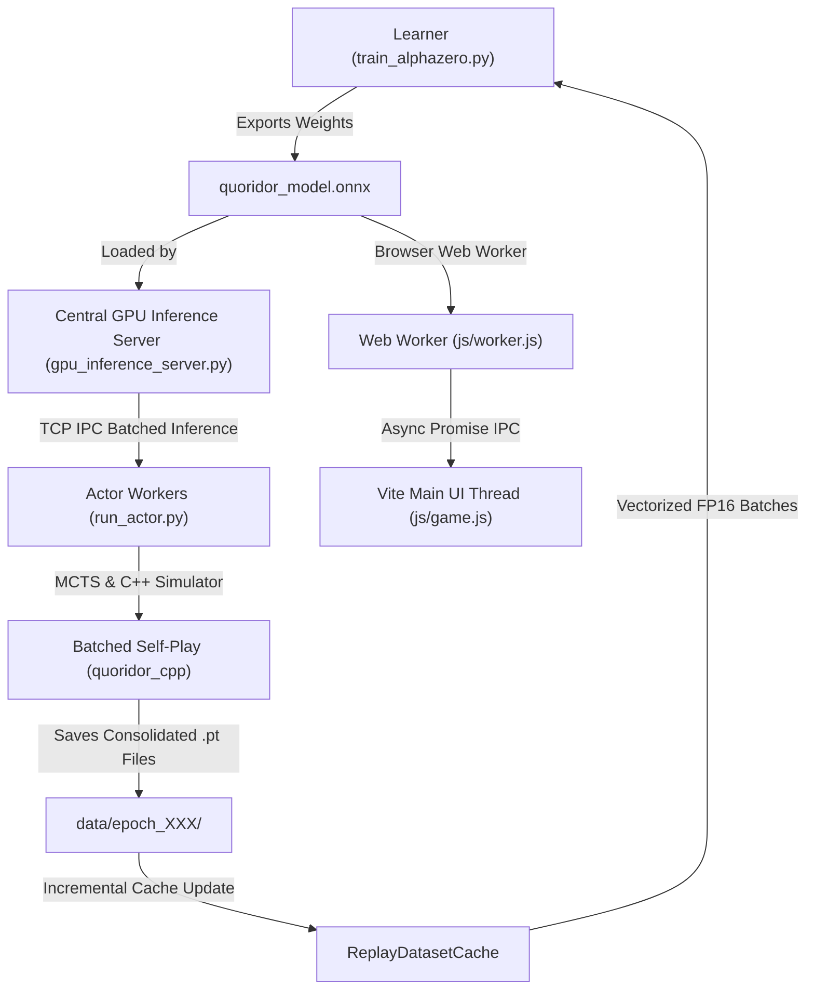

# Quoridor AlphaZero Architecture & System Design

This document details the high-level architecture, module design, data flow, and performance optimizations of the Quoridor AlphaZero reinforcement learning framework.

---

## 1. System Overview & Data Flow

The training pipeline uses an **Asynchronous Actor-Learner Architecture**. High-throughput C++ actor processes generate self-play games in parallel while a PyTorch learner process trains the neural network on GPU using Automatic Mixed Precision (AMP).

---

## 2. Component Breakdown

### A. C++ Core Engine & MCTS ([cpp/](../cpp))
- **`QuoridorGame`**: High-performance game state representation, move generator, wall placement validator, and BFS shortest pathfinder. Exposed to Python via `pybind11` in `quoridor_cpp`.
- **`MCTS` Engine**: Implements Monte Carlo Tree Search with PUCT selection formula ($c_{\text{puct}} = 1.4$) and Dirichlet noise ($\alpha = 0.07, \epsilon = 0.15$). Supports batched search execution (`MCTS.run_search_batched`) with **Virtual Loss Parallel Batching** (4 parallel leaf traversals per game step), reducing IPC round-trips to the central GPU inference server by 4x.

### B. Centralized GPU Inference Server ([gpu_inference_server.py](../gpu_inference_server.py))
- **Single GPU Context**: Dedicated process running PyTorch TorchScript JIT Traced execution with CUDA AMP (TF32/FP16) on RTX GPUs.
- **Dynamic Micro-Batching**: Receives `(M, 11, 9, 9)` evaluation requests from all connected actors over TCP socket IPC, aggregates requests into larger batches (up to batch size 256–512), and runs single unified GPU forward passes.
- **Auto Model Reloading**: Automatically polls for updated model checkpoints (`quoridor_checkpoint.pth`) per epoch and hot-reloads model weights seamlessly into the JIT execution context.

### C. Self-Play Actor Workers ([run_actor.py](../run_actor.py))
- **Parallel Workers**: Multiple independent actor processes (`run_actor.py`) run in parallel.
- **Remote Model Evaluator ([RemoteModelEvaluator](../onnx_inference.py))**: Sends state tensors over ultra-low-latency TCP sockets (`TCP_NODELAY`) to `gpu_inference_server.py`, receiving sliced policy and value tensors. Standalone mode provides fallback to local ONNX execution.
- **Consolidated Batch File Saving**: Self-play trajectories are saved into consolidated files containing entire game batches (`games_32_<timestamp>_<uuid>.pt`), reducing disk file creation by 32x.

### C. Neural Network & Learner ([train_alphazero.py](../train_alphazero.py) & [quoridor_model.py](../quoridor_model.py))
- **Network Topology ([QuoridorNet](../quoridor_model.py))**:
  - Input: `(11, 9, 9)` spatial board tensor (including active/opponent positions, wall maps, BFS path masks, normalized shortest path distances, wall counts, and path advantage scalar).
  - Perspective Rotation: State rotated by 180° on P2 turn to maintain active-player symmetry.
  - Convolutional Trunk: 10 Residual Blocks with Squeeze-and-Excitation (SE) channel attention and 128 channels.
  - Policy Head: Outputs 140 raw action logits (12 move/jumps + 64 horizontal walls + 64 vertical walls).
  - Value Head: Outputs scalar $V \in [-1.0, 1.0]$.
  - Auxiliary Path Head: Outputs 2 scalars in $[0.0, 1.0]$ predicting active and opponent remaining shortest path lengths.
- **Learner Optimizations**:
  - [ReplayDatasetCache](../train_alphazero.py): In-memory incremental data loader that reads only newly generated batch files per epoch, preventing disk I/O bottlenecks.
  - **Vectorized Pre-Stacked Tensors**: Pre-stacks dataset elements into contiguous PyTorch tensors for zero-copy CPU-to-GPU transfers (`non_blocking=True`).
  - **Automatic Mixed Precision (AMP / FP16)**: Uses `torch.amp.autocast('cuda')` and `GradScaler` for 2x-3x faster backpropagation on Tensor Cores.
  - **Multi-Task Loss**: Minimizes joint loss $\mathcal{L} = \mathcal{L}_{\text{policy}} + \mathcal{L}_{\text{value}} + 0.1 \cdot \mathcal{L}_{\text{aux}}$.
  - **cuDNN Autotuning**: Enables `torch.backends.cudnn.benchmark = True`.

### D. Web Frontend & Background Worker ([js/worker.js](../js/worker.js) & [js/worker-manager.js](../js/worker-manager.js))
- **Web Worker Offloading**: All heavy computations (AlphaZero MCTS lookahead, Minimax move generation, and depth-4 move quality analysis) are executed off the main UI thread in a background ES module Web Worker (`js/worker.js`).
- **Async Promise IPC**: Managed by `js/worker-manager.js`, returning non-blocking promises for AI move generation and move quality badges, keeping the main thread (DOM rendering, animations, hover effects) perfectly smooth at 60+ FPS.
- **WASM Multi-Threading**: Configures ONNX Runtime Web with WebAssembly multi-threading (`ort.env.wasm.numThreads = navigator.hardwareConcurrency || 4`) inside the worker thread context, utilizing all CPU cores for parallel neural network inference.

---

## 4. Win-Probability Move Quality Analysis ([js/move-analysis.js](../js/move-analysis.js))

The match history move analyzer converts engine evaluation scores into win probabilities:
$$W = \frac{1}{1 + 10^{-\text{eval} / 100}}$$

Move quality is classified based on **Win Chance Loss ($\Delta W = W_{\text{best}} - W_{\text{chosen}}$)** rather than raw heuristic point loss, eliminating false blunder classifications in complex wall positions:
- **Best / Brilliant / Great**: $\Delta W \le 2\%$
- **Excellent**: $\Delta W \le 6\%$
- **Good**: $\Delta W \le 12\%$
- **Inaccuracy**: $\Delta W \le 22\%$
- **Mistake**: $\Delta W \le 40\%$
- **Blunder**: $\Delta W > 40\%$

---

## 5. Training & Evaluation Pipeline

1. **Self-Play Generation**: Background actors simulate games using ONNX MCTS lookahead. The first 6 turns use proportional sampling over pawn moves for exploration before switching to greedy selection.
2. **Dataset Updates**: Completed batch trajectories (augmented with horizontal board symmetry) are saved to `data/epoch_XXX/`.
3. **GPU Training Pass**: The learner updates `ReplayDatasetCache`, pre-stacks tensors, shuffles mini-batches (size 64 by default), computes Policy Cross-Entropy, Value MSE, and Auxiliary Path MSE loss, and steps the Adam optimizer with `StepLR` (gamma 0.8 every 50 epochs).
4. **ONNX Synchronization**: Newly updated checkpoint weights are exported to `quoridor_model.onnx` so actor processes automatically hot-reload the latest model.
